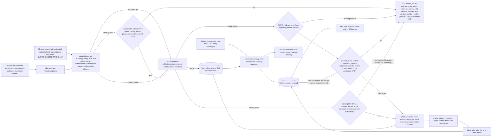

# 01 — Business process (As-Is / To-Be)

finance-subscriptions-api คือ cell ของ finance suite ที่เก็บทะเบียนค่าใช้จ่ายรายรอบ (subscription), การรีวิวว่าแต่ละรายการคุ้มหรือไม่ (subscription-review) และ alias ที่จับคู่บรรทัดใน statement กับ subscription ผู้ใช้คือ owner ผ่าน life-dashboard-web, finance-api และ MCP; finance-transactions-api ชี้มาที่ subscription ผ่าน `subscription_id` และทุกการเขียนส่ง event ที่มีแต่ข้อมูลอ้างอิงไป Kafka `finance.events.v1`

Last reviewed: 2026-11-27 · commit `83c31b5`

## As-Is (จากโค้ดวันนี้)

Sources: `cell.yaml`, `pyproject.toml` (platform-cellkit 1.1.1, entry points), `.github/workflows/relay-outbox.yml`, `migrations/0004_finance_events.sql`, `migrations/0005_cross_references.sql`, `README.md`, `PRODUCT.md`, `AGENTS.md`, `specs/005-finance-events-kafka/spec.md`, `specs/006-cross-service-references/spec.md`, `specs/008-workspace-erase/spec.md`, `specs/009-money-patch-version/spec.md`; platform-cellkit `v1.1.1` `src/cellkit/app.py`, `relay.py`, `refs.py`, `server.py`, `gateway.py`; callers: finance-api `src/finance_api/app.py` (`RESOURCES`, `SOURCES`, `ERASE_STAGES`), life-dashboard-web `lib/cells/finance.ts`, platform-jobs-worker `src/jobs.ts`

ข้อเท็จจริงสำคัญจากโค้ด:

- สาม resource: `/v1/subscriptions` (filter `status`, `scope`, `provider`, `billing_interval`; `name` + `provider` + `scope` ต้องไม่ซ้ำ), `/v1/subscription-reviews` (filter `subscription_id`, `verdict`; หนึ่งรีวิวต่อ subscription ต่อ `review_date`; เรียงตาม `review_date`), `/v1/subscription-aliases` (filter `subscription_id`, `mapping_status`; `alias` ไม่ซ้ำ); ทุกตัวมี list, stats, get, get-by-legacy-id, create (`Idempotency-Key`), patch, delete และ `POST /v1/<plural>/erase`
- `subscription` มี `referenced_by: transactions.transaction.subscription_id`: ก่อนลบหรือ erase cell ต้องอ่าน Kafka ให้ทัน (ไม่ได้ = 503 `references_unavailable`) แล้วปฏิเสธถ้ายังมี transaction ที่ยังอยู่ชี้มา
- `account_id` ถูกตรวจกับสำเนา account จาก event (refuse `closed`); `project_id` และ `goal_id` ไม่ถูกตรวจ
- event ใส่เฉพาะ field ใน `graph` ของแต่ละ resource (สถานะ, รอบบิล, วันที่, id อ้างอิง, `scope`, `currency`) ไม่มี `amount`, `name`, `provider` หรือ notes
- finance-api อ่าน subscription ที่ `active` และ `trial` ใน `/v1/overview`, อ่านทั้งสาม resource ใน export และ erase review กับ alias ก่อน subscription (`ERASE_STAGES`)
- cell ไม่เรียกหรือยกเลิกอะไรที่ผู้ให้บริการ และไม่จับคู่บรรทัด statement เอง (`PRODUCT.md` out of scope)
- life-dashboard-web เรียกผ่าน `EMPIRE_SUBSCRIPTIONS_API` ซึ่ง URL จริง (ตรงหรือผ่าน gateway) อ่านจากโค้ดไม่ได้ [ต้องยืนยัน]
- โหมด `GATEWAY_ASSERTION_MODE` และโหมด signed events ที่ production ตั้งไว้ อ่านจากโค้ดไม่ได้ [ต้องยืนยัน]

## To-Be (จาก `PRODUCT.md` §Measures และ `specs/004-identity-issuer-trust/spec.md`)

ไม่มีแผนภาพ To-Be ของกระบวนการ: specs 001–009 อยู่ในโค้ดแล้ว เหลือเพียงสิ่งที่เอกสารเขียนไว้ว่ายังไม่ทำ:

- `PRODUCT.md` §Measures (proposed, ยังไม่มีอะไรเก็บ): subscription ที่ active แต่ไม่มีรีวิวใน 90 วัน, alias ที่ค้าง `unresolved` (เป้า 0), สัดส่วนรีวิว `not_worth_it` ที่ subscription ยัง active, 5xx และ p95 latency ของ `/v1/subscriptions`
- `specs/004-identity-issuer-trust/spec.md`: โค้ดรับ issuer ที่สอง (platform-identity) ได้แล้ว แต่การเปิดใช้ใน production ต้องได้ owner go แยก

## Gap

| ID | As-Is → To-Be | Status | Owner | Evidence |
|---|---|---|---|---|
| G1 | ไม่มีอะไรเก็บ measures → วัด subscription ที่ไม่ถูกรีวิวใน 90 วัน, alias ที่ค้าง unresolved และ not_worth_it ที่ยัง active | todo | claude | `PRODUCT.md` §Measures ("nothing collects them yet") |
| G2 | รองรับ issuer platform-identity ในโค้ดแล้ว → owner go ให้เปิดใน production (สถานะตัวแปรจริง [ต้องยืนยัน]) | decide | owner | `specs/004-identity-issuer-trust/spec.md` Status; platform-cellkit `src/cellkit/server.py` `_identity_trust` |
| G3 | `PRODUCT.md` ยังเขียนว่า `subscription_id` ของ transactions เป็นแค่ตัวเลขที่ไม่ถูกตรวจ และว่า life-dashboard-web เรียก `/v1/subscription-usages`, `/v1/subscription-charges` → แก้ให้ตรงกับ SPEC-006 และโค้ด dashboard ปัจจุบัน (ไม่พบสอง path นี้) | todo | claude | `PRODUCT.md` §Users; `cell.yaml` `referenced_by`; life-dashboard-web `lib/cells/finance.ts` |

## Open questions

- life-dashboard-web และ cell นี้คุยกันตรงหรือผ่าน edge gateway และ cell ตั้ง `GATEWAY_ASSERTION_MODE` เป็น enforce แล้วหรือยัง [ต้องยืนยัน]
- ใครหรืออะไรสร้าง subscription-review และ subscription-alias ในการใช้งานจริง (ไม่พบ writer อัตโนมัติในโค้ดที่อ่าน; ค่าเริ่ม `source` คือ `subscription-review`) [ต้องยืนยัน]
